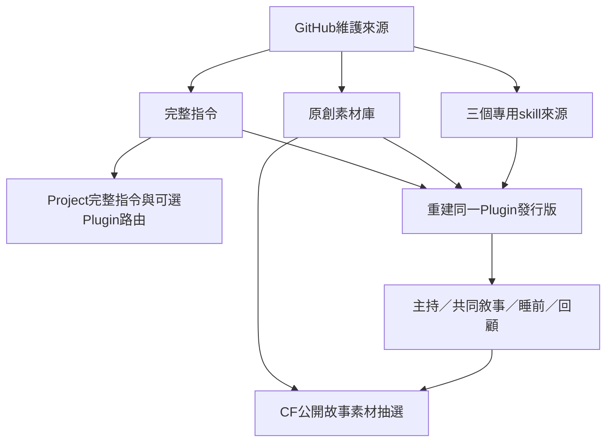

# Plugin架構、安裝與GitHub維護

版本1.5.0，2026-10-18。GitHub維護完整指令、素材、四個skills與可重建套件；Project直接放完整規則，同一個人私人Plugin提供skills與可選MCP。沒有新增付費服務、embedding、LLM呼叫、資料庫或背景工作。

## 目前部署與使用

- Project：1.5.0完整PROJECT_INSTRUCTIONS.md，保留台灣口語、成人陪同與四個skills路由；不依賴手機成功載入skill才有完整帶法。先前1.4.1精簡入口保留本機備份。記憶與空間權限不變。
- Plugin：更新原本的個人私人Plugin，4個skills、完整素材與同一MCP入口；沒有另建同名Plugin、送審公開目錄或擴權。公開的是GitHub原始碼。
- CF：重新打包1.5.0素材文件；抽樣邏輯仍1.2.0、148項原子卡。N／Q教學示例不當成抽樣卡或情緒資料。
- GitHub：來源及生成套件共同以Git維護。push不會自動替換Project、帳號Plugin或既有聊天。

在既有Project另開新聊天，直接說「月亮，開場吧」。需要使用skills時由家長選已安裝Plugin；若當前介面沒提供，Project全文也能玩。手機即時語音是否載入Plugin及調用MCP仍需實測，不能從安裝或一般文件推定。

## 來源分工

| 來源 | 用途 |
| --- | --- |
| PROJECT_INSTRUCTIONS.md | 唯一完整規範，8,000字元內，直接貼Project；主持skill由此生成 |
| PROJECT_PLUGIN_INSTRUCTIONS.md | 已確認載入skills後可選的精簡入口，含正向主持備援；兩份擇一 |
| STORY_MATERIALS.txt | 148項原子素材、情境／長短故事、N區8組敘事與Q區12組需要回應示例 |
| skill-sources/*.md | 共同敘事、睡前與家長回顧三個條件流程 |
| plugin.config.json | 套件身分、公開作者資訊、版本、呈現及已驗證MCP入口 |
| plugins/moon-robot-family-play/ | 自動產物，不手改；主skill內含全文、附件含完整素材 |
| .agents/plugins/marketplace.json | 支援repo marketplace的客戶端發現入口，不代表手機自動安裝 |

主skill依需要選擇加戲、示範、降低負擔、支持或讓位。共同敘事由邀請啟用，不從短音節推定能力不足。睡前沿用角色安穩收束；回顧只根據實際可見內容，區分孩子提出與AI補寫。各skill排除成人專案維護，避免研究討論變成兒童口吻。

draw_story_materials只提供公開分類與ID的唯讀抽選；成人啟用、工具確實可用且缺靈感時才選用。停止、主講、拒絕及真實問題不抽；不傳兒童逐字稿或情緒，不把工具當成必備。[Worker說明](worker.md)。

## 這次Project差異

| 1.4.1精簡入口 | 1.5.0完整規範 |
| --- | --- |
| 以載入主持skill為主，含必要備援 | 核心完整規則直接在Project，可用時採用同一Plugin |
| 防空轉與停止規則較突出 | 正向需要回應放在前段，依具體情境選帶法 |
| 主動給情節，沒有完整情境帶法 | 興奮採用、卡住示範、無聊換表演、累了收束、委屈支持、能講讓位 |
| 素材含N區敘事示例 | Q區再增12組實際主持示例，Plugin內附 |

家長選定先在原故事加戲、再視反應換玩法，並明確授權沒有待討論取捨就同步四個目標。本次由此授權套用，不另加背景自動同步；未修改記憶、安全或全域Plugin權限。

## 未來發行

改正式來源、版本與CHANGELOG，再執行build:plugin、check:plugin、npm test、package:plugin。ZIP置於忽略的.local；檢查四個skills、MCP、素材、圖示及指紋。

讀取同一帳號Plugin目前release，以guarded update更新；保留身分、私人範圍、連線與呈現。帳號作者資訊和release記錄只放本機，不把下載正規化manifest推公開repo。Git提交、Plugin發行、Project同步與CF部署分別核對；只完成哪層就報哪層。

## 驗證範圍

程式及打包檢查與線上8項MCP檢查分開記錄。完整指令、素材及專用skills從帳號回讀核對；Project儲存後重開確認全文相符。[16組正向主持前後對照](attuned-hosting-checks.md)另含備援及既有18案回歸，都是合成文字代理，沒有孩子成效或手機即時語音證據。

官方[Plugins](https://learn.chatgpt.com/docs/plugins)、[skills](https://learn.chatgpt.com/docs/skills-and-plugins)、[Project](https://learn.chatgpt.com/docs/projects)及[套件格式](https://developers.openai.com/plugins/build/plugins)說明產品與封裝能力；[Voice文件](https://learn.chatgpt.com/docs/features/voice)不替代本帳號、這個Project、手機即時語音的實測。
