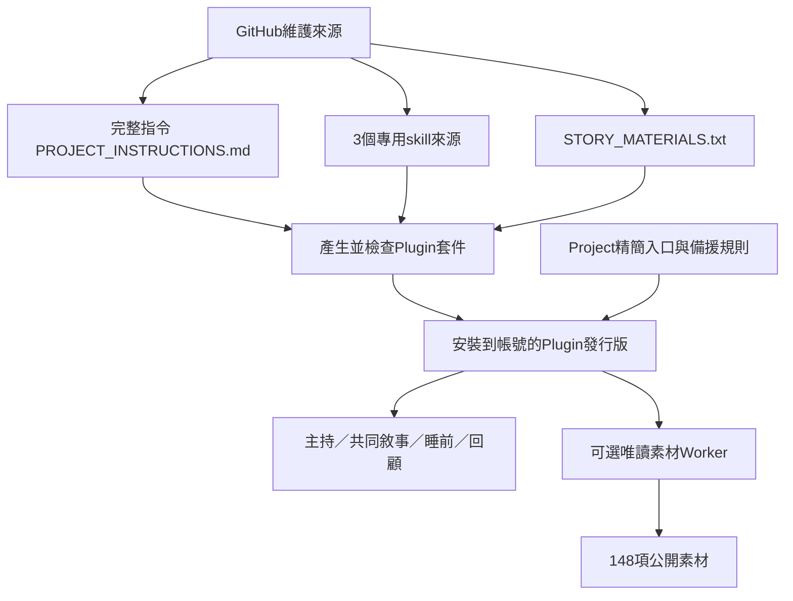

# Plugin架構、安裝與GitHub維護

版本1.4.1，2026-10-18。GitHub是指令、素材、skills與套件結構的維護來源。Plugin是可安裝的發行快照；Cloudflare Worker繼續只提供公開素材。沒有新增LLM呼叫、embedding、資料庫、背景工作或付費服務。



## 哪裡維護、哪些自動產生

| 檔案 | 維護方式 |
| --- | --- |
| PROJECT_INSTRUCTIONS.md | 唯一完整遊戲主規範，也是未確認語音支援時的完整備援 |
| PROJECT_PLUGIN_INSTRUCTIONS.md | Plugin模式的Project入口，含必要界線及載入失敗備援；切換前由家長查看 |
| STORY_MATERIALS.txt | 唯一素材來源，含148項卡片、情境卡、長短故事與8組敘事引導示例 |
| skill-sources/*.md | 共同敘事、睡前、家長回顧的條件流程；都沿用完整主規範 |
| plugin.config.json | Plugin身分、版本、呈現資訊、已驗證MCP入口；不放憑證 |
| plugins/moon-robot-family-play/ | 自動產物，供安裝及完整Git備份；不要直接手改 |
| .agents/plugins/marketplace.json | 支援repo marketplace的客戶端可發現套件，不代表手機已自動安裝 |
| scripts/build-plugin.mjs、package-plugin.py | 維護者在發行時執行；親子遊戲不需執行，也不需要家長安裝Python或Node |

主skill內直接包含完整規範，不只有遠端連結。素材檔也放入套件內。生成時檢查來源版本，保存來源SHA-256及檔案指紋，防止副本漂移；外部工具的素材不是遊戲必備條件。

## 四個skills與一個MCP

| 名稱 | 何時使用 | 行為界線 |
| --- | --- | --- |
| moon-play-host | 成人陪同的遊戲開場、短回應接戲 | 不因呼喚月亮轉成天文題材；保留拒絕、安靜與主講界線 |
| moon-story-together | 家長要求帶他說故事，或孩子邀請一起編 | 一次補一個動作或結果，能講就讓位，不把短音節自動當訓練 |
| moon-bedtime | 準備睡覺、溫柔收尾 | 沿用角色收束，不加新危機、追問或下一集 |
| moon-parent-review | 家長明確要求回顧 | 只看實際可見內容，分清孩子自發、提示與AI擴寫，不做發展診斷 |
| draw_story_materials | 成人啟用且實際提供工具、需要靈感時 | 只傳公開分類與ID，不接收孩子逐字對話；停止／主講時不抽卡 |

skills的描述排除一般研究及專案維護，避免在成人討論設定時變成兒童主持人口吻。既有Worker維持1.2.0，介面與148項卡片未變，不需重架。

## Project入口的新舊差異

| 項目 | 完整指令模式 | Plugin模式 |
| --- | --- | --- |
| Project內文字 | 貼完整主規範 | 貼精簡入口與備援規則，指向已安裝Plugin的主skill |
| 完整規則來源 | 當時貼入的全文 | 主skill內包含的當次發行全文 |
| 素材 | 可另上傳STORY_MATERIALS.txt | 套件已包含素材，讀不到仍可用內建素材 |
| 未來更新 | 更新repo後重新貼全文 | 更新repo、重建並更新同一Plugin；重開聊天確認已載入新版 |
| 載入不可用 | 仍按貼入全文玩 | 直接使用精簡備援；家長問設定時才說明，語音持續不可用就改貼完整版本 |

1.4.0階段只準備入口及建立Plugin，當時未改動遠端Project指令；1.4.1在家長要求先檢查再完成後已套用入口，見下方記錄。來源上傳未變更。Project精簡入口不是自動安裝、工具授權或強制載入器；不能只留一個GitHub網址。

### 本次讀到的線上設定

2026-10-18以唯讀方式查看本專案設定，實際仍是最初完整指令，尚未套用repo的1.1～1.4改版；沒有在設定欄位輸入或儲存任何修改。相較目前線上版本，待確認的差異為：

| 目前線上設定 | 待確認的Plugin入口 |
| --- | --- |
| 一般每次1～3個短句 | 主持4～7句、完整故事8～12句；共同創作與主講時縮短 |
| 喜好起點含月亮，沒有主持人／介面語意預設 | 月亮幾乎一律是呼喚主持人或指介面 |
| 沒有Plugin載入指示 | 先用已安裝的完整主持skill，依情境選另外3個skill |
| 不自行使用外部工具 | 仍禁止自行外部操作；成人啟用且工具實際提供時才可抽公開素材，不傳兒童逐字對話 |
| 原本已有成人陪同、安全、拒絕、安靜及主講規則 | 保留並強化；載入失敗仍有必要備援規則 |

專案目前採「僅限專案」記憶，介面提示不能使用Work。本方案的目標入口是在Chat中選用Plugin，不改記憶、空間權限或其他全域設定；仍需在該Project的新聊天確認skills是否可載入。當時已把入口檔及差異交付，未立即修改；家長後續要求先查空轉再完成，1.4.1已完成檢查及入口替換。

## 帳號狀態與使用方式

1.4.0已建立為個人私人Plugin；帳號Plugin頁面顯示在「已安裝」清單，內容列出4個skills與1個MCP伺服器。這與把原始碼放在public GitHub不同；沒有送審公開Plugin目錄，也沒有開放帳號內其他資料。

家長可在Plugin頁面或已安裝清單開啟「月亮機器人｜親子遊戲」。在既有Project內另開一個聊天，用@選此Plugin或moon-play-host，再請它確認載入版本1.4.1；接著才測語音。沒有必要另建專案或把孩子對話傳回GitHub。

查看上方差異後，由家長選擇是否用PROJECT_PLUGIN_INSTRUCTIONS.md全文取代Project原指令；不要同時堆入兩份互相重複的入口。尚未確認手機語音載入時，保留完整模式。切換入口不需要對所有已安裝Plugins擴權。

## 未來更新流程

修改上述正式來源，同步版本及CHANGELOG；重新產生、檢查、打包，提交來源與自動產物到GitHub：

```text
npm run build:plugin
npm run check:plugin
npm test
npm run package:plugin
```

ZIP放在忽略的.local目錄，與Plugin目錄分開。每次打包都先確認來源一致、四個skills、MCP、素材、圖示、版本及封包內容；程式不刪除未知檔案，而是報錯讓維護者檢查。

由Plugin Creator讀取同一Plugin的目前release，使用update_plugin更新，而非另建同名Plugin。帳號Plugin ID與release保存在本機.local/account-plugin.json，沒有憑證、不提交公開repo；若本機資料不在，先從已建立的個人Plugins找回正確ID。伺服器可能正規化作者資訊及加入相容manifest，別把含帳號資料的下載副本直接推回公開repo。

Git提交與更新帳號Plugin是兩個步驟。只有repo改了、Plugin未更新時，要清楚說明尚未同步；不假裝GitHub push後既有聊天立即變新。只有改動原子素材或Worker程式才需要另外部署Cloudflare。

## 已驗證與尚待驗證

- 已通過29項程式測試、類型檢查、Worker打包及Plugin的ZIP完整性檢查。
- 線上素材入口8項檢查通過，包括工具清單、實際抽選、近期排除、睡前收尾、停止狀態及來源限制。
- 已從帳號讀回4個skills、完整主規範、素材檔與MCP設定，並在Plugin頁面確認「已安裝」。帳號完整規範及素材與repo產物逐字相符。
- 當前維護聊天尚未出現新Plugin工具，未宣稱已透過帳號路由呼叫；需要新聊天確認。
- 尚未驗證孩子實際對話、手機即時語音的skill載入與MCP調用；程式測試不代表教育成效。

家長可用合成內容先測：叫「月亮」能否延續場景；說「帶他說故事」後孩子給一詞能否擴成動作；說「不要講話」再說「嗯／月亮」能否仍保持停止；要求回顧時是否沒有把AI內容算成孩子成果。不要為測試錄音上傳兒童對話。

## 官方依據與可用範圍

[Plugins官方說明](https://learn.chatgpt.com/docs/plugins)確認Plugin可含skills與MCP、支援手機Chat／Work，並說明安裝後的新聊天載入方式；[Skills說明](https://learn.chatgpt.com/docs/skills-and-plugins)說明按需求選用，不保證把名字寫進Project就每次載入。

[官方套件文件](https://developers.openai.com/plugins/build/plugins)提供manifest、MCP與repo marketplace格式；[Project文件](https://learn.chatgpt.com/docs/projects)說明跨聊天共用指令與來源。這些不等於已驗證每一種手機語音體驗。[Voice文件](https://learn.chatgpt.com/docs/features/voice)描述的桌面及配對iOS能力，不作為一般手機語音支援這套Plugin的保證。

## 1.4.1主持空轉修正

完整規範、精簡備援、共同敘事／睡前skills及素材示範已同步修正，並更新同一帳號Plugin；四個skills及MCP已回讀核對。18組多輪合成案例與8組備援情境由不同文字代理生成，另由一個代理評讀；前後各70輪，詳見[實際輸出與限制](hosting-idle-regression.md)。這不代表手機語音實測，Project入口已備份原文後套用1.4.1，重新開啟設定核對全文相符；記憶與空間權限保留，手機語音載入仍待實測。
